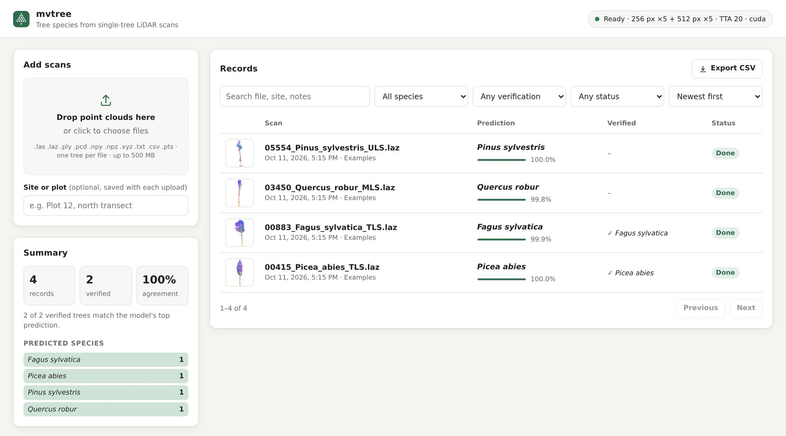
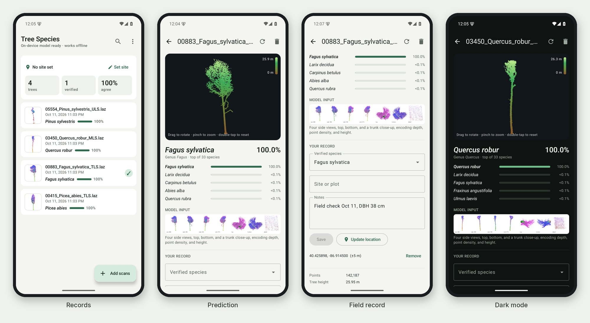
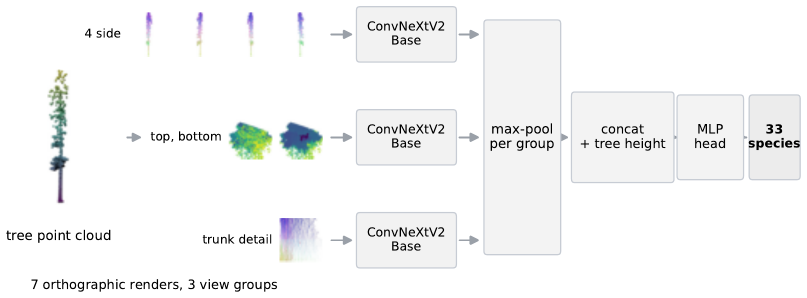

<div align="center">

# Three LiDARs, Twenty-Five Datasets
### Cross-Source Generalization in Tree-Species Recognition

**Accepted at WACV 2027** (Evaluations & Datasets track)

[](LICENSE)


[](https://doi.org/10.5281/zenodo.13255198)

https://github.com/user-attachments/assets/94bc975c-49b0-4367-aa68-9faa105d9ed1

**Give it a laser scan of one tree, and it tells you the species.**

[Quick start](#quick-start) · [Usage](#usage) · [Results](#results) · [Reproduce the paper](#reproduce-the-paper) · [Documentation](docs/README.md) · [Citation](#citation)

</div>

## Overview

This is the code for our WACV 2027 paper on [FOR-species20K](https://doi.org/10.5281/zenodo.13255198), the largest public
LiDAR benchmark for individual-tree species classification. It has 33 species and about 20,000 trees from 25 source
datasets, scanned by terrestrial (TLS), mobile (MLS), and drone (ULS) laser scanning. The repository has two parts:

- **A tree-species classifier.** It scores **85.0% overall accuracy on the official hidden test**, first on the
  leaderboard at submission (the previous best was 79.5%). You can run it from the command line, from Python, in a
  self-hosted web app, or offline in an Android app.
- **A cross-source evaluation protocol.** If a species is learned only from other source datasets, accuracy on the
  same trees falls from **95% to 60%**. The released splits and scripts measure any model the same way.

## Quick start

```bash
git clone https://github.com/JaeLee18/FOR20K-lidar-tree-species.git
cd FOR20K-lidar-tree-species
uv sync                                                 # install; pip, conda, and Docker: docs/installation.md
./predict.sh examples/05554_Pinus_sylvestris_ULS.laz    # downloads the weights on first use (5.4 GB)
```

```text
05554_Pinus_sylvestris_ULS.laz  (53,839 points, height 33.2 m)
  1. Pinus_sylvestris         100.0%  ##############################
  2. Larix_decidua              0.0%
  3. Quercus_petraea            0.0%
  4. Pseudotsuga_menziesii      0.0%
  5. Quercus_rubra              0.0%
```

The input is one segmented tree per file, in metres with Z up: `.las` `.laz` `.ply` `.pcd` `.xyz` `.txt` `.csv`
`.pts` `.npy` `.npz`. A CUDA GPU is recommended (about 2 s per tree on an RTX 4090); a CPU works too
([timings](docs/installation.md)).

## Usage

### Command line

```bash
./predict.sh scans/ -o predictions.csv                  # every scan in a folder -> CSV with the top 5 species
./predict.sh tree.laz --device cpu --folds 0 --tta 1    # fast CPU preview: one model, no augmentation
```

All options, input requirements, and output formats: [docs/inference.md](docs/inference.md).

### Python

```python
from mvtree.predict import Predictor

predictor = Predictor()                          # loads the models in ./weights
result = predictor.predict_file("tree.laz")
print(result.species, result.confidence)         # Pinus_sylvestris 0.9998
print(result.top(3))                             # [('Pinus_sylvestris', 0.9998), ...]
```

### Web app (self-hosted)

`mvtree serve` starts a website on your machine. Drop scans into the browser to get predictions. Every result is
kept as a record that you can search, check against field identifications, and export to CSV.



Setup, sharing on a lab network, Docker, and the HTTP API: [docs/web_app.md](docs/web_app.md).

### Android app (offline)

The app classifies scans on the phone without a network connection and keeps field records: verified species,
notes, and GPS position. It runs one fold of the 256 px model with 8-bit weights, which is as accurate as the
full-precision fold (89.1% on its 3,542 held-out trees).



Build, install, and tests: [android/README.md](android/README.md).

## How it works

<p align="center"></p>

1. **Render.** Each tree is drawn as seven orthographic images: four sides, top, bottom, and a trunk slice. The
   three channels are depth, point density, and height, not colour.
2. **Classify.** Three ConvNeXtV2-Base networks read the side, top/bottom, and trunk views. Their features are
   joined with the tree height and mapped to 33 species. A logit-adjusted loss handles the rare species.
3. **Average.** The prediction averages 20 augmented passes, 5 fold models, and two render sizes (256 and 512 px).

Details: [docs/method.md](docs/method.md). An [85-second film](docs/assets/video/overview.mp4) shows the pipeline
from scanning to prediction.

## Model weights

| Model | Public-set 5-fold OA / macro-F1 | Hidden test OA | Size |
|---|---|---|---|
| `convnextv2_256` | 0.886 / 0.843 | 84.0%\* | 2.6 GB |
| `convnextv2_512` | 0.895 / 0.856† | n/a | 2.6 GB |
| both resolutions (the default) | 0.899 / 0.861† | **85.0%\*†** | 5.3 GB |

`python -m mvtree download` (or `./predict.sh` on first use) downloads them into `weights/` and verifies their
checksums. Manual download and the optional LightGBM model: [weights/README.md](weights/README.md).

\* The submitted files also blended the optional LightGBM model, which changes public-set accuracy by less than 0.001
([docs/leaderboard.md](docs/leaderboard.md)).

† The released 512 px weights were retrained after the paper because the original checkpoints were not kept. The paper
reports 0.894 / 0.855 (512 px) and 0.899 / 0.860 (both). The 85.0% entry used the original 512 px weights; with the
retrained ones, 97.4% of the hidden-test predictions are unchanged.

## Results

**Official hidden test** (species-balanced, %). Full table: [docs/results.md](docs/results.md).

| Method | Input | OA | F1 |
|---|---|---|---|
| DetailView (Frey & Schindler), previous best | images | 79.5 | 78.0 |
| Ensemble PointNet++, best point-based | points | 75.6 | 74.9 |
| Ours, 256 px | images | 84.0 | 83.0 |
| **Ours, 256 + 512 px** | images | **85.0** | **85.0** |

**Same species, unseen source.** The same 5,566 trees are scored by a model trained on the random split and by a
model that never saw a tree from their (source, species) pair. The species itself is still learned from other
sources.

| Backbone | Random split | Unseen source | Drop |
|---|---|---|---|
| ConvNeXtV2-Base×3 (ours) | 94.8% | 60.2% | 34.5 pts |
| DINOv2-Base×3 | 91.5% | 48.6% | 43.0 pts |
| DenseNet-201×3 | 85.7% | 46.0% | 39.7 pts |

Controls, per-species results, and how to evaluate your own model: [docs/cross_source.md](docs/cross_source.md).

## Reproduce the paper

```bash
make paper-tables        # every public-set number in the paper, from the released predictions (CPU, about 1 min)
```

Training from scratch (data, renders, five folds, test-set submission) is described in
[docs/training.md](docs/training.md), and the leaderboard files in [docs/leaderboard.md](docs/leaderboard.md).

## Repository layout

```
FOR20K-lidar-tree-species/
├── mvtree/          Python package: readers, renderer, model, predictor, CLI, and web app
├── android/         offline Android app (Kotlin)
├── scripts/         data, training, evaluation, export, and media pipelines (scripts/README.md)
├── configs/         training recipes
├── splits/          cross-validation and cross-source splits
├── results/         out-of-fold predictions and leaderboard files behind the paper
├── examples/        four sample scans
├── weights/         model weights are downloaded here (manifest and checksums in git)
├── data/            dataset metadata; the raw data is downloaded here
├── docs/            guides, figures, and screenshots
├── docker/          Dockerfile and Compose file
├── requirements/    pinned pip requirements and a conda environment
├── tests/           pytest suite (CPU)
├── predict.sh       one-command inference
├── Makefile         common tasks (make help)
└── pyproject.toml   package metadata; uv.lock pins exact versions
```

## Limitations

- **New sources are harder.** On trees from a (source, species) pair that was not in training, accuracy fell from
  95% to 60%. Validate on local reference trees before using predictions from new sensors, regions, or protocols.
- **Closed set of 33 species**, mostly European, with some North American and Australian species. There is no
  "unknown" class.
- **The example scans come from the public labeled set**, which four of the five fold models saw during training, so
  their near-100% confidences are not an accuracy estimate.

More in the [model card](docs/model_card.md).

## Citation

```bibtex
@inproceedings{lee2027threelidars,
  title     = {Three LiDARs, Twenty-Five Datasets: Cross-Source Generalization in Tree-Species Recognition},
  author    = {Lee, Jae Joong and Benes, Bedrich},
  booktitle = {IEEE/CVF Winter Conference on Applications of Computer Vision (WACV)},
  year      = {2027}
}
```

Please also cite the dataset:

```bibtex
@article{puliti2025,
  title   = {Benchmarking tree species classification from proximally sensed laser scanning data:
             Introducing the {FOR-species20K} dataset},
  author  = {Puliti, Stefano and Lines, Emily R. and M{\"u}llerov{\'a}, Jana and Frey, Julian and Schindler, Zoe
             and Straker, Adrian and Allen, Matthew J. and Winiwarter, Lukas and Rehush, Nataliia and
             Hristova, Hristina and others},
  journal = {Methods in Ecology and Evolution},
  volume  = {16},
  number  = {4},
  pages   = {801--818},
  year    = {2025}
}
```

## License

The code is under [GPL-3.0-or-later](LICENSE). The FOR-species20K data, including the four example scans and the
metadata CSV, is distributed by its authors under GPL-3.0-or-later
([Zenodo 13255198](https://doi.org/10.5281/zenodo.13255198)). The released weights were trained on that data.

## Acknowledgements

We thank the FOR-species20K authors and the 25 contributing data providers; Frey & Schindler for DetailView, which
introduced the seven-view rendering this work builds on; and the
[timm](https://github.com/huggingface/pytorch-image-models) maintainers.
