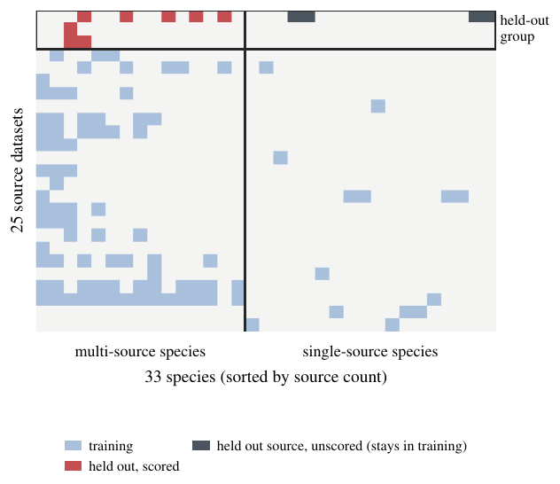

# Cross-source evaluation protocol

FOR-species20K pools 25 source datasets. Each was collected with a single LiDAR type, and 18 of the 33 species occur
in only one source. The official species-stratified random split places every source in both training and test, so
a model can partly name a species by recognising which dataset a tree came from. The protocol below measures how
well a model recognises a species in a source where that species was never seen during training.

<p align="center"></p>

## Splits

All files live in [`splits/`](../splits). Each has one row per public labeled tree and one column per fold; a cell
is `train`, `val` (scored in that fold), or `excluded`.

| File | What fold *k* does | Used for |
|---|---|---|
| `random_5fold.csv` | species-stratified 5-fold split (seed 42) | model selection, random-split scores |
| `source_holdout_5fold.csv` | holds out group G<sub>k</sub> of source datasets, but only for species that also occur outside G<sub>k</sub>; trains on everything else | the cross-source gap |
| `count_matched_5fold.csv` | removes the same number of trees per (species, LiDAR type) cell as the holdout, drawn at random across all sources | control: is the gap caused by having fewer training trees? |
| `lodo_5fold.csv` | scores the same trees as the holdout but removes every tree of the held-out datasets (`excluded`) | control: does residual exposure to the held-out dataset matter? |

`source_groups.json` lists the datasets in each group. The 25 datasets are assigned largest first to the currently
smallest group, which balances the groups by tree count.

## Definition

For held-out group G<sub>k</sub>, the eligible species are those that also appear in some dataset outside G<sub>k</sub>:

S<sub>k</sub> = { c : c appears in a dataset outside G<sub>k</sub> }

The model trains on every tree except the trees of species in S<sub>k</sub> that lie in G<sub>k</sub>, and is scored on
exactly those trees. A scored (source, species) cell therefore has no training tree from its own source, while the
species keeps training examples from other sources. Single-source species always stay in training.

**Support control.** A (fold, species, LiDAR type) cell is counted in the headline only if it keeps at least
**S = 50** training trees of the same LiDAR type outside G<sub>k</sub> and has at least **H = 20** held-out trees.
This separates cross-source shift from a species nearly disappearing from training. `cross_source_eval.py` also
sweeps S ∈ {30, 50, 80}.

**Paired comparison.** Every scored tree is evaluated twice: by the holdout model and by the random-split model's
out-of-fold prediction for the same tree. The drop is computed on identical trees, so only the split differs. We
report a tree-weighted drop and an unweighted mean over species.

## Reference numbers (ConvNeXtV2-Base ×3, 256 px)

```
scored: 5566 trees, 8 species
species mean (unweighted): random 0.815 -> holdout 0.360 (drop 0.455)
tree-weighted:             random 0.948 -> holdout 0.602 (drop 0.345)
per-fold drop (tree-weighted): fold 0: 0.195, fold 1: 0.610, fold 2: 0.440, fold 3: 0.268, fold 4: 0.252
leave-one-species-out species-mean drop: 0.407 to 0.502

control arms on the same eligible cells (accuracy):
  fold 2: random 0.889 | source-holdout 0.448 (n=1276) | count_matched 0.941 (n=1276)
  lodo, pooled over folds [0, 2]: drop from random 0.419 (source-holdout) vs 0.367 (lodo)
```

| Species | n | Random | Holdout | Drop |
|---|---|---|---|---|
| *Acer pseudoplatanus* | 24 | 0.79 | 0.00 | 0.79 |
| *Betula pendula* | 210 | 0.91 | 0.25 | 0.66 |
| *Fagus sylvatica* | 44 | 0.93 | 0.34 | 0.59 |
| *Quercus robur* | 182 | 0.92 | 0.36 | 0.57 |
| *Picea abies* | 1983 | 0.95 | 0.55 | 0.40 |
| *Pinus sylvestris* | 3048 | 0.96 | 0.69 | 0.27 |
| *Pseudotsuga menziesii* | 43 | 0.93 | 0.70 | 0.23 |
| *Fraxinus excelsior* | 32 | 0.13 | 0.00 | 0.13 |
| **All** | **5566** | **0.95** | **0.60** | **0.35** |

## Evaluating another model

Any model works, including point-cloud networks, as long as you can save out-of-fold probabilities.

1. Train fold *k* on the trees marked `train` in column `fold_k` and predict the trees marked `val`. Do this for
   `random_5fold.csv` and `source_holdout_5fold.csv`. Use the same model selection rule for both.
2. Save each fold as `.npz` with `treeID` (N,), `fold` (N,), `probs` (N, 33), and `species` (33,), with classes in
   the order of `mvtree.SPECIES` (alphabetical). Put them in one directory as `oof_fold{k}.npz` or concatenate them
   into one file.
3. Run:

```bash
python scripts/eval/cross_source_eval.py --random runs/mine_random --holdout runs/mine_holdout
python scripts/eval/cross_source_eval.py ... --arm count_matched=runs/mine_matched:splits/count_matched_5fold.csv
python scripts/eval/source_classifier.py --oof runs/mine_random     # how much source identity the outputs carry
```

`source_classifier.py` fits a logistic regression (5-fold CV over trees) that predicts the source dataset from the
33 species probabilities. ConvNeXtV2 reaches 0.691 (chance 0.040), and 0.601 on species that occur in more than one
source.
