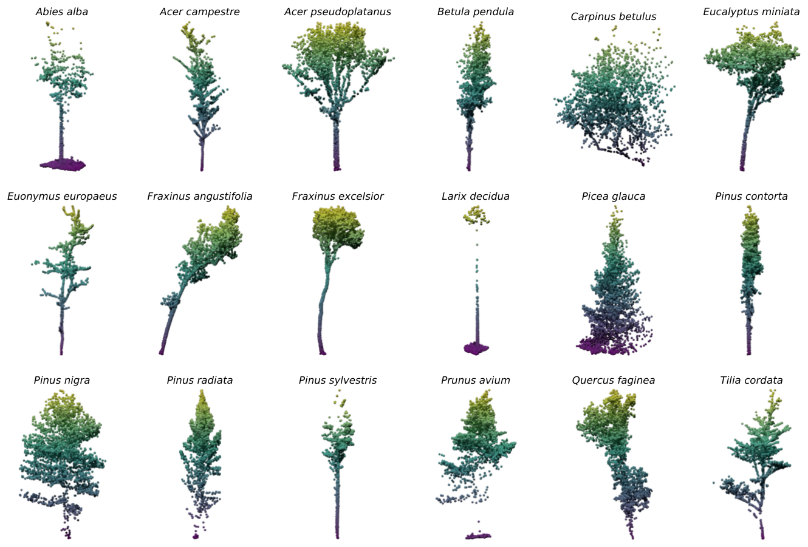
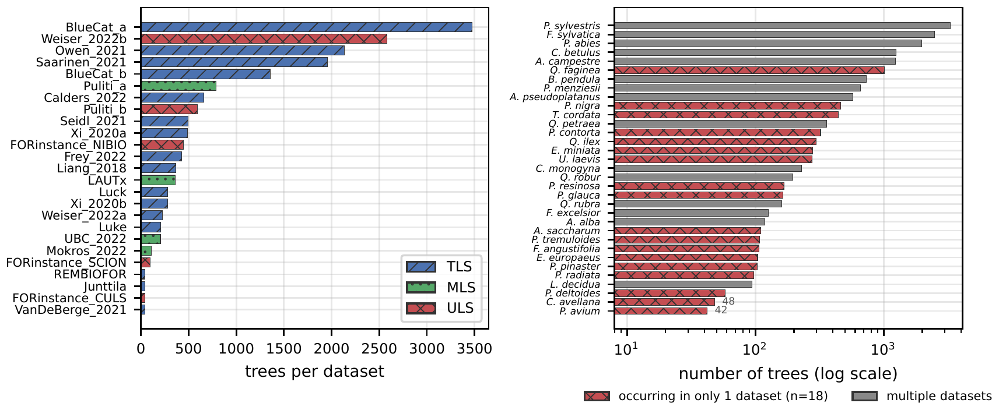
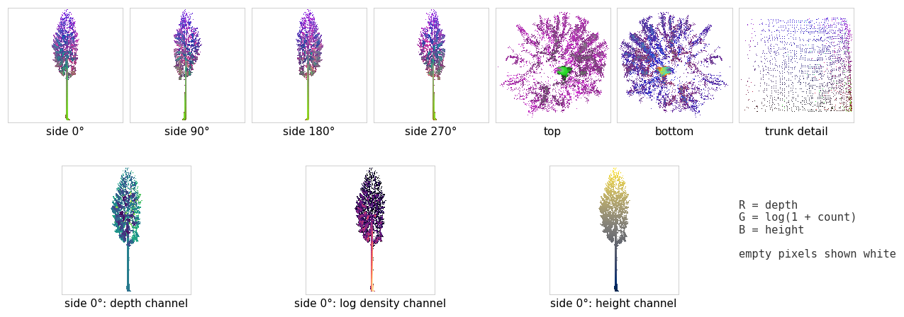

# How it works

An [85-second film](assets/video/overview.mp4) (1080p, with sound) walks through the same pipeline, from scanning to
prediction.

## Data

[FOR-species20K](https://doi.org/10.5281/zenodo.13255198) has 33 species and about 20,000 single-tree point clouds
from 25 source datasets. The public labeled set has 17,707 trees, and the hidden test set has 2,255 trees that are
scored on Codabench. Each source dataset was recorded with one kind of LiDAR: terrestrial (TLS), mobile (MLS), or
drone (ULS).

The datasets differ a lot in size, and 18 of the 33 species occur in only one of them. This is why the
[cross-source protocol](cross_source.md) matters.

## Geometric renders

Each tree is projected orthographically into seven views: four sides at 0, 90, 180 and 270°, top, bottom, and a
trunk slice 1.0 to 1.5 m above the ground (20 to 40% of the height for trees under 5 m). The three image channels are
not colours. They encode the depth of the front-most point, the log point count per pixel, and the absolute height,
each min-max normalised per view.

The renderer is [`mvtree/render.py`](../mvtree/render.py). The released weights only work on renders made exactly
this way, which `tests/test_render.py` checks against the per-point loop the paper's renders were made with.

## Network

Three ImageNet-pretrained ConvNeXtV2-Base backbones (FCMAE, from `timm`) process the side, top/bottom, and trunk
groups. Features are max-pooled within each group, concatenated with the tree height, and classified by a two-layer
head (264.7M parameters in total). Normalisation uses statistics of the renders, not ImageNet statistics. The model
is [`mvtree/model.py`](../mvtree/model.py).

## Training

Logit-adjusted cross-entropy ([Menon et al., 2021](https://arxiv.org/abs/2007.07314)) handles the long-tailed
33-species distribution without resampling. The recipe is AdamW, 3 head-only epochs and then 37 full epochs with a
cosine schedule (backbone 3e-5, head 3e-4), effective batch 32, and mixed precision. Augmentation is limited to
horizontal flips and cyclic shifts of the side views, because colour jitter, vertical flips, and mixup corrupt the
geometric channels. The full recipe and commands are in [Training](training.md).

## Inference

For every fold model, the softmax is averaged over 20 augmented passes, then over the five folds, and then across the
256 and 512 px models. The predictor is [`mvtree/predict.py`](../mvtree/predict.py).
