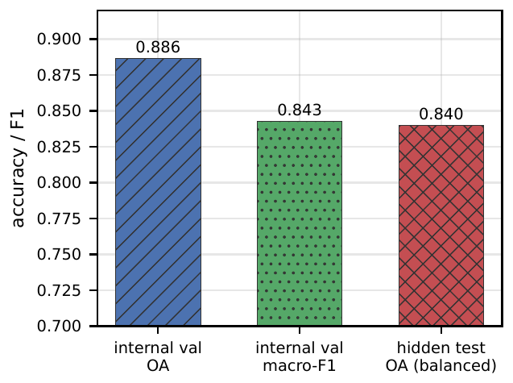
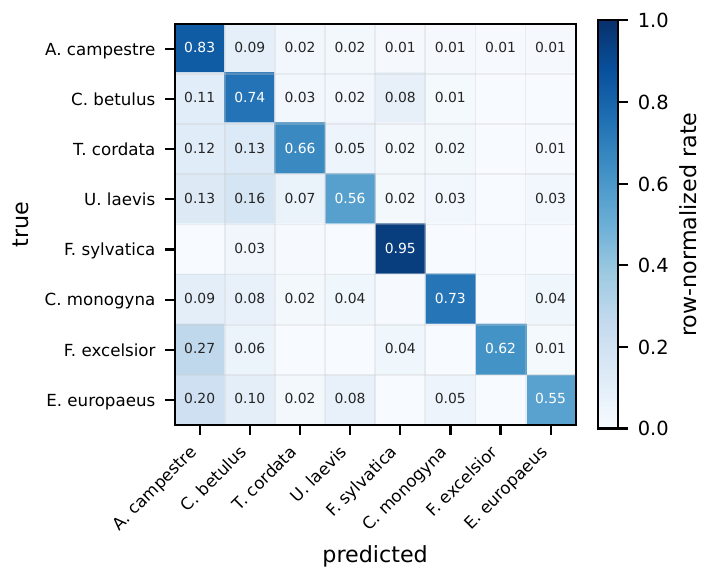
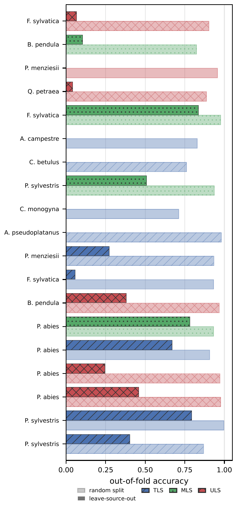

# Results

All numbers can be recomputed: the hidden-test files are in [`results/leaderboard/`](../results/leaderboard) and the
public-set predictions are in [`results/oof/`](../results/oof). See [Training](training.md#reproducing-the-paper).

## Official hidden test

FOR-species20K leaderboard, species-balanced test set, %:

| Method | Input | OA | Precision | Recall | F1 |
|---|---|---|---|---|---|
| DetailView (Frey & Schindler) | images | 79.5 | 82.3 | 76.7 | 78.0 |
| YOLOv5 | images | 77.9 | 84.2 | 75.0 | 77.3 |
| SimpleView | images | 76.2 | 76.9 | 75.5 | 75.6 |
| Ensemble PointNet++ | points | 75.6 | 78.2 | 73.5 | 74.9 |
| MinkNet | points | 73.7 | 79.9 | 70.6 | 72.3 |
| PointMixer | points | 71.1 | 74.4 | 65.5 | 71.1 |
| PointAugment + DGCNN | points | 68.3 | 72.5 | 65.7 | 70.3 |
| **ConvNeXtV2×3 + LA-CE (ours, 256 px)** | images | 84.0 | 87.0 | 82.0 | 83.0 |
| **+ multi-resolution ensemble (ours)** | images | **85.0** | **89.0** | **83.0** | **85.0** |

By LiDAR type, the multi-resolution model scores 85.6 (TLS), 93.4 (MLS), and 79.2 (ULS). How the submitted files
were made is described in [Leaderboard](leaderboard.md).

## Public labeled set, 5-fold out-of-fold

| Backbone | Render | OA | macro-F1 | TLS | MLS | ULS |
|---|---|---|---|---|---|---|
| DenseNet-201×3 (DetailView-style baseline) | 256 | 0.818 | 0.761 | 0.814 | 0.860 | 0.816 |
| DINOv2-Base×3 | 224 | 0.819 | 0.758 | 0.805 | 0.894 | 0.836 |
| ConvNeXtV2-Base×3 (ours) | 256 | 0.886 | 0.843 | 0.879 | 0.934 | 0.894 |
| ConvNeXtV2-Base×3 (ours) | 512 | 0.894 | 0.855 | 0.888 | 0.928 | 0.900 |
| **+ multi-resolution ensemble** | 256+512 | **0.899** | **0.860** | **0.893** | **0.936** | **0.903** |

**Compare the hidden test with macro metrics.** The hidden test samples a similar number of trees per species, so its
overall accuracy should be compared with **macro** metrics on the public set (0.860 macro-F1 against 0.850 hidden
OA), not with the long-tailed public OA (0.899). The chart shows this for the 256 px model.

 

**Remaining errors.** Co-occurring deciduous species in dense mixed forest (*Acer*, *Carpinus*, *Fraxinus*, *Ulmus*,
*Tilia*, *Euonymus*) account for about half of the remaining errors.

## Cross-source generalization: same species, unseen source

The same 5,566 evaluation trees (8 species, each keeping at least 50 training trees of the same LiDAR type from other
sources) are scored twice: by the random-split model, and by a model trained without their (source, species) cell.

| Backbone | Random split | Unseen source | Drop |
|---|---|---|---|
| ConvNeXtV2-Base×3 (ours) | 94.8% | 60.2% | 34.5 pts |
| DINOv2-Base×3 | 91.5% | 48.6% | 43.0 pts |
| DenseNet-201×3 | 85.7% | 46.0% | 39.7 pts |

Averaged over species instead of trees, ConvNeXtV2 falls from 81.5% to 36.0%.

Two controls rule out reduced training data as the cause:

- Removing the same number of trees per (species, LiDAR type) at random across sources keeps 94.1% accuracy,
  against 44.8% for the source-structured removal in the same fold.
- Removing those source datasets entirely (leave-one-dataset-out) changes the drop only from 42 to 37 points.

The source dataset can also be predicted from the 33 species probabilities alone with 69% accuracy (chance: 4%).
The protocol, per-species numbers, and how to run it on your own model are in
[Cross-source protocol](cross_source.md).

 
