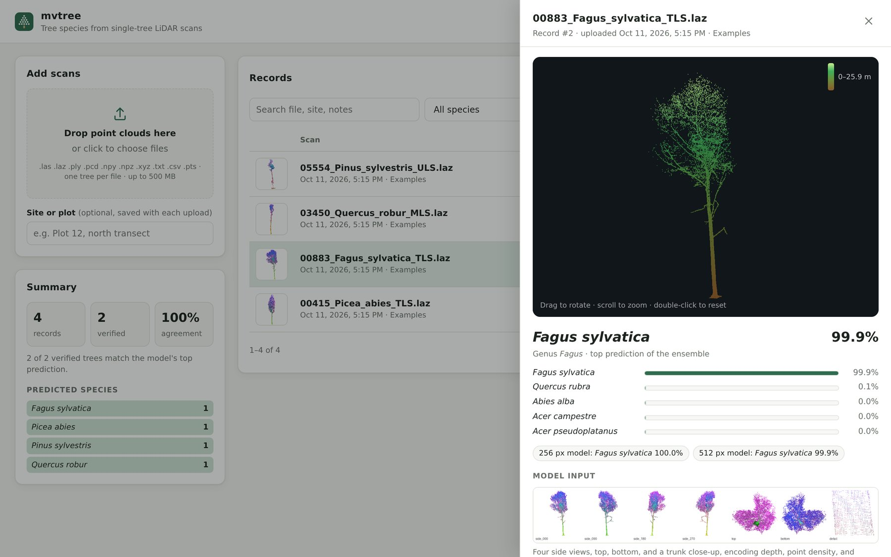
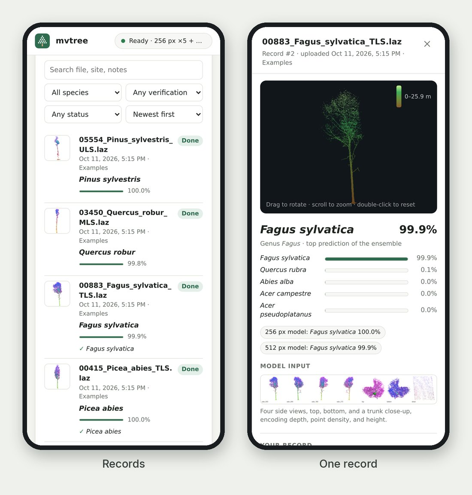

# Web app (self-hosted)

`mvtree serve` runs a small website on your own machine. Drop scans into the browser to get predictions. Every
result is saved as a record that you can search, check against field identifications, and export.

```bash
mvtree serve                 # then open http://127.0.0.1:8000   (or: make serve)
```


## Records

Each record keeps:

- the class probabilities, including each resolution's own vote
- the seven renders the model saw, and a rotatable 3D view of the points
- the original scan, so it can be downloaded or predicted again
- your own **verified species**, **site or plot**, and **notes**



Records can be searched and filtered by species, by status, or by "model disagrees with verified". They can be
re-run, deleted, or exported to CSV. Once you add verified species, the summary shows how often the model agrees
with your field identifications.

Everything lives in one folder, `./mvtree_data/` by default: a SQLite database, plus one sub-folder per record for
the scan and previews. Back up or move that folder to keep the records. The server needs nothing beyond the
package's own dependencies, because it uses Python's `http.server` and `sqlite3`.

## Options

```bash
mvtree serve --host 0.0.0.0 --token "$(openssl rand -hex 16)"   # share on a lab network; the page asks for the token once
mvtree serve --data-dir /srv/mvtree --no-keep-scans              # keep results and previews, delete raw uploads
mvtree serve -r 256 --device cpu --folds 0 --tta 1               # quick setup for a machine without a GPU
```

Shared on a lab network, the same pages work in a phone's browser:

<p align="center"></p>

## Docker

```bash
docker compose -f docker/compose.yaml up -d      # builds the image and serves on http://localhost:8000
```

The Compose file ([`docker/compose.yaml`](../docker/compose.yaml)) mounts `./weights` and stores records in
`./mvtree_data`. To require a token, `export MVTREE_TOKEN=...` before starting it.

## Speed and memory

One worker owns the model and predicts uploads in arrival order. On an RTX 4090 the full 256 + 512 px ensemble
(20 augmented passes) takes about 6 s per tree. At start-up the server loads all ten networks, about 12 GB of GPU
memory, and runs a warm-up pass, which takes about a minute. On smaller GPUs, use `-r 256` or `--low-memory`. If a
tree runs out of GPU memory, it is retried with a smaller batch, which does not change the result.

## Security

The server listens on `127.0.0.1` unless you pass `--host`. On a shared network, set `--token` (or
`$MVTREE_TOKEN`). It is a lab tool and is not hardened for the open internet: to expose it publicly, put it behind
a reverse proxy with HTTPS.

## HTTP API

For scripts:

| Request | Does |
|---|---|
| `POST /api/records?filename=tree.laz&site=Plot%207` | upload one scan (the raw file is the request body); returns the queued record |
| `GET /api/records?q=&species=&status=&verified=&sort=&limit=&offset=` | list and search records |
| `GET /api/records/{id}` | one record with all 33 probabilities |
| `PATCH /api/records/{id}` | edit `verified_species`, `site`, `notes` (JSON body) |
| `POST /api/records/{id}/rerun` · `DELETE /api/records/{id}` | predict again · delete the record and its files |
| `GET /api/records/{id}/scan` | download the original scan |
| `GET /api/export.csv` · `GET /api/status` | every record as CSV · model state, queue, and summary |

```bash
curl --data-binary @tree.laz "http://127.0.0.1:8000/api/records?filename=tree.laz"
```

With `--token`, send the header `X-Mvtree-Token: <token>`.
